# K-Flix DevOps Pipeline

A CI/CD pipeline for the K-Flix movie app on AWS: every push is tested, built and scanned; a manual run also builds a Docker image, pushes it to ECR and scans it, and ArgoCD deploys it to an EKS cluster that Terraform builds and Prometheus watches. Built as a portfolio project to show end-to-end DevOps practice.

[](https://github.com/kchimbodza/k-flix-devops-cicd-pipeline/actions)

## At a glance

| | |
|---|---|
| **What it does** | Takes the K-Flix React app from `git push` to a running pod on Kubernetes, with tests, code analysis, image scanning, GitOps deploy, monitoring and Slack alerts |
| **Skills shown** | CI/CD, GitOps, Infrastructure as Code, Kubernetes, container security, observability |
| **Tech** | GitHub Actions, Vitest, SonarCloud, Docker, Trivy, AWS ECR, Terraform, AWS EKS, ArgoCD, Prometheus, Grafana, Alertmanager, Slack |
| **Cost control** | The cluster is torn down after every session (`destroy.sh`) and rebuilt on demand (`deploy.sh`), ~$0.21/hr while running |

## Architecture

<p align="center"></p>

1. **Build (CI):** a push to `master` runs one GitHub Actions job: Vitest, Vite build and SonarCloud (report only, does not block). Starting the workflow by hand (Actions tab → Run workflow) also does the Docker build and push to ECR, then a Trivy scan of the pushed image. While the cluster is torn down, this keeps AWS untouched unless I ask for it.
2. **Deploy (CD):** ArgoCD runs inside the cluster and watches the `k8s/` folder in Git. It applies changes on its own, undoes manual changes (self-heal) and deletes what was removed from Git (prune).
3. **Run:** one pod holds two containers: nginx serves the React build and proxies `/api/` to a json-server sidecar on `localhost:3001`. A LoadBalancer service gives it a public URL.
4. **Monitor:** kube-prometheus-stack (Helm) adds Prometheus, Grafana and Alertmanager in a `monitoring` namespace. Alerts go to Slack `#k-flix-alerts`.

**Why this architecture**

| Choice | Why |
|---|---|
| ArgoCD (pull) instead of `kubectl` in GitHub Actions (push) | The cluster pulls from Git, so cluster credentials never leave the cluster or sit in GitHub Secrets. |
| SonarCloud instead of SonarQube | No server to run or pay for; free for public repos; one step in GitHub Actions. |
| Trivy instead of Snyk or Grype | Native GitHub Action, scans OS packages and app dependencies in one pass, free with no rate limits. |
| Terraform for the cluster | The whole stack can be destroyed after a demo and rebuilt the same way, which keeps AWS costs low. |
| Bigger nodes than t3.micro | t3.micro allows only 4 pods (ENI limit); ArgoCD + the monitoring stack + K-Flix need 10+. |
| json-server as a sidecar | The app's small REST backend runs in the same pod, so nginx reaches it on `localhost` with no extra service. |

## Results

**CI history** (from `gh run list -R kchimbodza/k-flix-devops-cicd-pipeline`, checked 13 Nov 2026)

| Runs | Passed | Failed | Notes |
|---|---|---|---|
| 7 | 4 | 3 | The first 3 failed while the repo was being assembled (see below). The runs after that passed, taking 4–8 min, until the SonarCloud token expired (see below). |

The same workflow was first built in [k-flix-react-app](https://github.com/kchimbodza/k-flix-react-app/actions): 10 runs, 7 passed, 3 failed while the SonarCloud and Trivy steps were set up.

**Checks I re-ran locally** (13 Nov 2026, Node 26, Terraform 1.14.0; no cloud resources)

| Check | Result |
|---|---|
| `npm test` (Vitest) | 1 file, **3/3 tests pass** |
| `npm run lint` (ESLint) | 0 errors |
| `npm run build` (Vite) | builds, 330 kB JS (98 kB gzip) |
| `terraform validate` | **valid** |
| `terraform fmt -check` | 1 alignment fix needed in `main.tf` |

**Evidence from the live cluster** (screenshots in [`docs/screenshots/`](docs/screenshots/))

- `terraform plan`: **54 resources to add** (SS-10).
- ArgoCD: app **Synced and Healthy**, auto-sync on, 4 resources healthy (SS-16).
- Self-healing: a deleted pod was replaced by a new one, **2/2 containers Running**, about 2 minutes later (SS-21).
- Grafana dashboard with pod and node metrics (SS-19). Alerts reached Slack (SS-20), including `KubeletTooManyPods` (a node at 100% of its pod capacity).
- SonarCloud first analysis: 2.3k lines of code, security rating C (7 issues), reliability A, maintainability A, 14.3% duplication; quality gate not yet computed (SS-05).

## What worked and what didn't

| | What | Detail |
|---|---|---|
| ✅ | GitOps deploy and self-heal | ArgoCD synced the cluster from Git (SS-16) and a deleted pod was replaced on its own (SS-21). |
| ✅ | Rebuild on demand | `deploy.sh` / `destroy.sh` bring the whole stack up and down, so the cluster costs nothing between demos. |
| ✅ | Secret caught before it went public | GitHub push protection blocked a Slack webhook URL; it was removed from history and the file is now in `.gitignore`. |
| ❌ fixed | First 3 CI runs here failed | 2 at `Setup Node.js` ("Dependencies lock file is not found", the app source was not in the repo yet), 1 at the SonarCloud step (exit code 3); fixed by adding the app source and moving to `sonarqube-scan-action@v6`. |
| ❌ fixed | Pods stuck `Pending` | `t3.micro` hit its pod limit ("Too many pods"); larger nodes fixed it. |
| ❌ fixed | `terraform destroy` blocked | LoadBalancers and Elastic IPs created by Kubernetes were not in Terraform state; `destroy.sh` now removes them first. |
| ⚠️ limit | Trivy does not block | The workflow uses `exit-code: '0'`, so CRITICAL/HIGH CVEs are reported but the job still passes. Separately, `npm audit --omit=dev` (13 Nov 2026) lists 8 high and 1 moderate advisories in runtime dependencies (axios, follow-redirects, form-data, nanoid), all with fixes available. |
| ❌ fixed | Expired SonarCloud token (Nov 2026) | Every push failed at the SonarCloud step (HTTP 403) while tests and build passed. SonarCloud is now report-only (`continue-on-error`), and the AWS steps run only on a manual run, so an expired token or AWS key can't block testing. |
| ⚠️ limit | Image tag is not written back to Git | CI pushes `:latest` and the commit SHA but does not edit `k8s/deployment.yaml`, which uses `:latest`. Git does not change when a new image is built, so the new image reaches the cluster only when the pod is recreated. |
| ⚠️ limit | Small test suite | 3 smoke tests check that `App` renders with every page mocked. Coverage is not sent to SonarCloud. |
| ⚠️ limit | Data resets on restart | json-server writes to an `emptyDir` volume seeded from a ConfigMap, so users and watchlists are lost when the pod restarts. |
| ⚠️ drift | Docs vs code | `terraform/main.tf` sets `t3.small` nodes, while `CHALLENGES.md` #3 describes an upgrade to `t3.medium` that was not kept (now noted there; cost figures use `t3.small`). `deploy.sh` also scales the node group with the AWS CLI, which `CHALLENGES.md` (#4) says to avoid. |

Full write-ups of 7 issues with root cause and fix: [CHALLENGES.md](CHALLENGES.md). Step-by-step operations: [RUNBOOK.md](RUNBOOK.md).

---

## Tech Stack

| Category | Tool | Purpose |
|---|---|---|
| Frontend | React 19, Vite, Tailwind CSS v4 | App framework |
| Testing | Vitest | Unit tests |
| Code Quality | SonarCloud | Bugs, code smells, security hotspots |
| Security | Trivy | Container vulnerability scanning |
| Containers | Docker, AWS ECR | Image build and registry |
| IaC | Terraform | EKS cluster, VPC, node group |
| CI | GitHub Actions | Test, build, scan, push |
| CD / GitOps | ArgoCD | Automated deploy to Kubernetes |
| Orchestration | AWS EKS (Kubernetes 1.31) | Container orchestration |
| Monitoring | Prometheus, Grafana | Metrics collection and dashboards |
| Alerting | Alertmanager, Slack | Incident notifications |

<details>
<summary><b>Pipeline stages in detail</b> (from <code>.github/workflows/ci.yml</code>)</summary>

**1. Test**
```yaml
- name: Run Vitest with coverage
  run: npm run test:coverage
```
The job stops here if any test fails.

**2. Build**
```yaml
- name: Build app
  run: npm run build
```
Vite compiles the React app into a production bundle. TMDB settings come from GitHub Secrets.

**3. Code quality**
```yaml
- name: SonarCloud scan
  uses: SonarSource/sonarqube-scan-action@v6
```
SonarCloud checks for bugs, code smells, security hotspots and duplication.

**4. Docker build and push to ECR**
```yaml
docker build ... -t $ECR_REGISTRY/$ECR_REPOSITORY:$IMAGE_TAG -t $ECR_REGISTRY/$ECR_REPOSITORY:latest .
docker push $ECR_REGISTRY/$ECR_REPOSITORY:$IMAGE_TAG
docker push $ECR_REGISTRY/$ECR_REPOSITORY:latest
```
Multi-stage Dockerfile: a Node stage builds the app, an nginx stage serves it. Images are tagged with the commit SHA (traceability) and `latest`.

**5. Security scan**
```yaml
- name: Run Trivy vulnerability scan
  uses: aquasecurity/trivy-action@v0.36.0
  with:
    severity: CRITICAL,HIGH
    exit-code: '0'
```
Trivy scans the pushed image for known CVEs. The action is pinned to a version tag to reduce supply-chain risk. With `exit-code: '0'` it reports findings without failing the job.

**6. GitOps deploy via ArgoCD**
ArgoCD watches the `k8s/` folder. When the manifests change, it syncs the cluster with no manual `kubectl apply`. Enabled: automated sync, self-heal, prune.

**7. Monitoring**
Prometheus scrapes cluster metrics every 30 seconds. Grafana dashboard 15760 shows pod CPU, memory and node health. Alertmanager routes alerts to Slack.

</details>

## Repository Structure

```
k-flix-devops-cicd-pipeline/
├── .github/workflows/ci.yml    # CI pipeline
├── k8s/
│   ├── namespace.yaml
│   ├── configmap.yaml          # Seed data for json-server
│   ├── deployment.yaml         # nginx + json-server pod (ArgoCD watches this folder)
│   └── service.yaml            # LoadBalancer service
├── terraform/
│   ├── main.tf                 # VPC + EKS cluster and node group
│   ├── variables.tf            # Region, cluster name, Kubernetes version
│   ├── outputs.tf              # Cluster endpoint, ECR URL
│   └── versions.tf             # Provider versions
├── src/                        # React app source
├── Dockerfile                  # Multi-stage build
├── nginx.conf                  # SPA routing + /api/ proxy to json-server
├── deploy.sh                   # Full restore script
├── destroy.sh                  # Full teardown script
├── RUNBOOK.md                  # Operational runbook
└── CHALLENGES.md               # Issues encountered + fixes
```

## Infrastructure

**EKS cluster:** `k-flix-cluster` in `us-east-2`, Kubernetes 1.31  
**Node group:** 2 nodes (min 1, max 3); instance type set in `terraform/main.tf`  
**VPC:** custom VPC with public and private subnets across 2 AZs, one NAT gateway  
**ECR:** `<AWS_ACCOUNT_ID>.dkr.ecr.us-east-2.amazonaws.com/k-flix`

> The cluster is torn down after every demo session and rebuilt on demand using `deploy.sh` to keep AWS costs down (~$0.21/hr while running, see [RUNBOOK.md](RUNBOOK.md)).

## Quick Start

### Restore the full stack
```bash
./deploy.sh
```

### Tear down everything
```bash
./destroy.sh
```

### Open the UIs
```bash
# ArgoCD
kubectl port-forward svc/argocd-server -n argocd 8080:443
# Visit https://localhost:8080

# Grafana
kubectl port-forward svc/kube-prometheus-stack-grafana -n monitoring 3000:80
# Visit http://localhost:3000 — admin / kflix-admin123
```

## Screenshots

### CI Pipeline — GitHub Actions All Stages Green
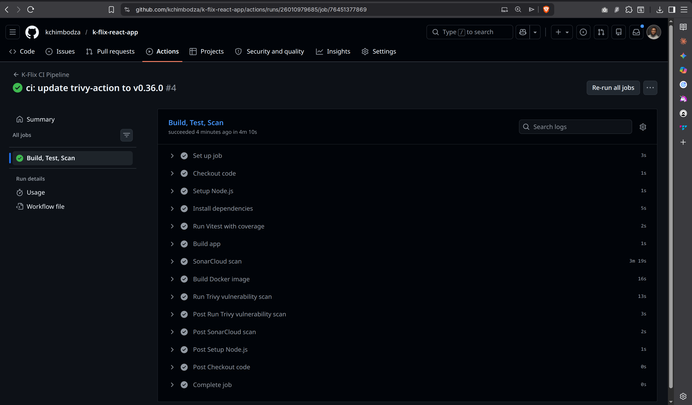

### Vitest — Tests Passing
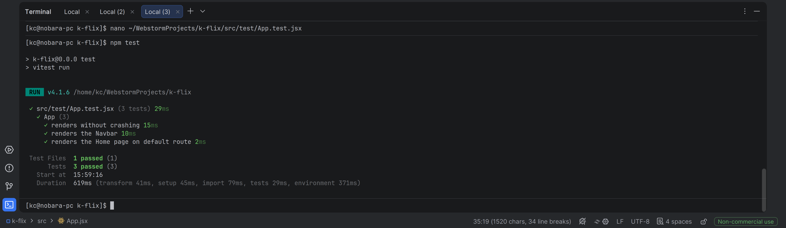

### SonarCloud — First Analysis
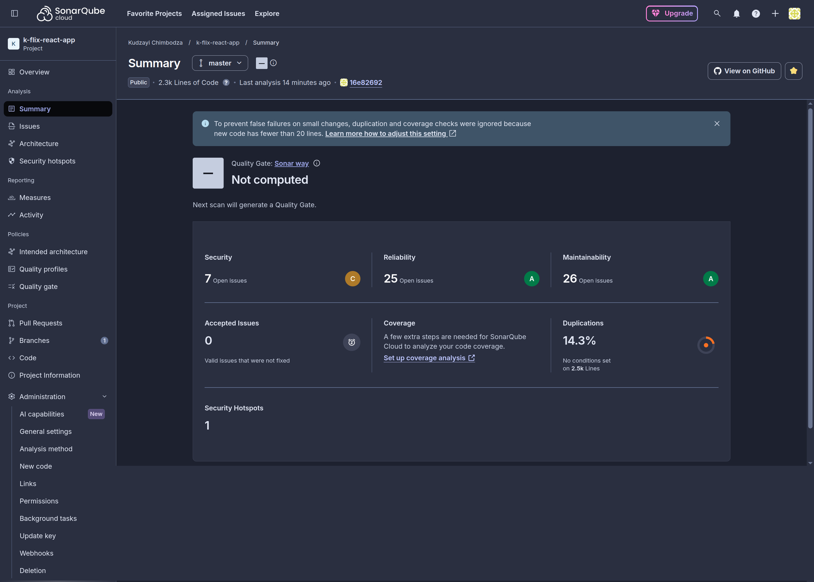

### Docker Image Pushed to ECR
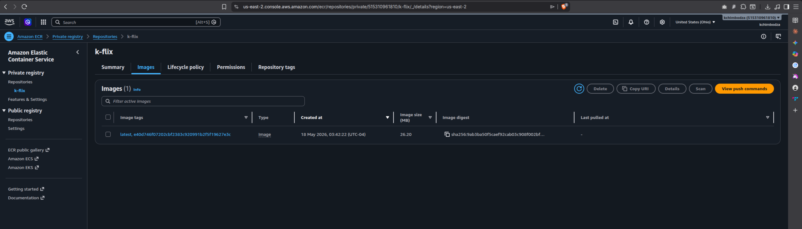

### Terraform Plan — 54 Resources
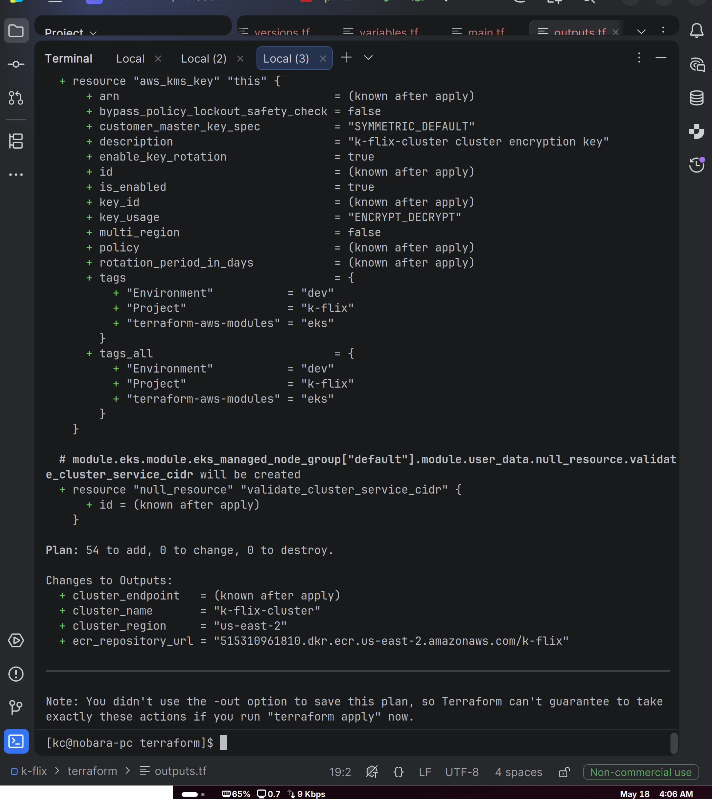

### EKS Cluster Live
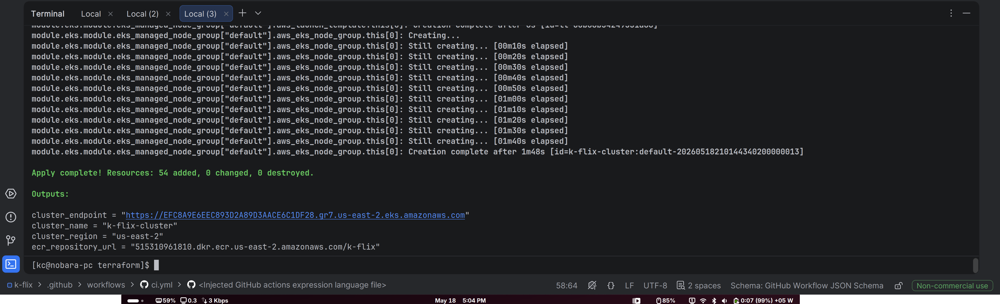

### ArgoCD — Installed
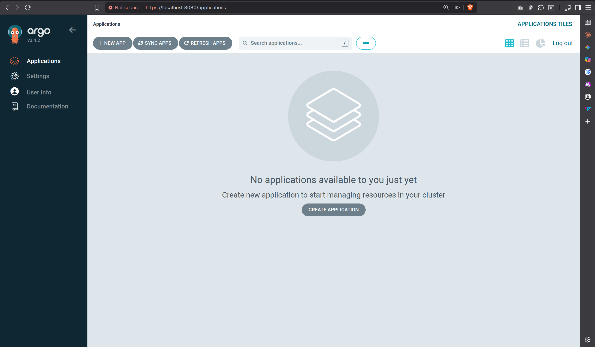

### ArgoCD — Synced & Healthy Deployment Tree
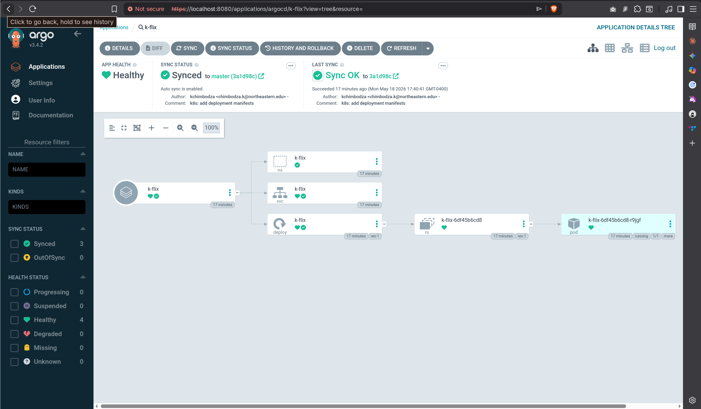

### K-Flix Live on EKS
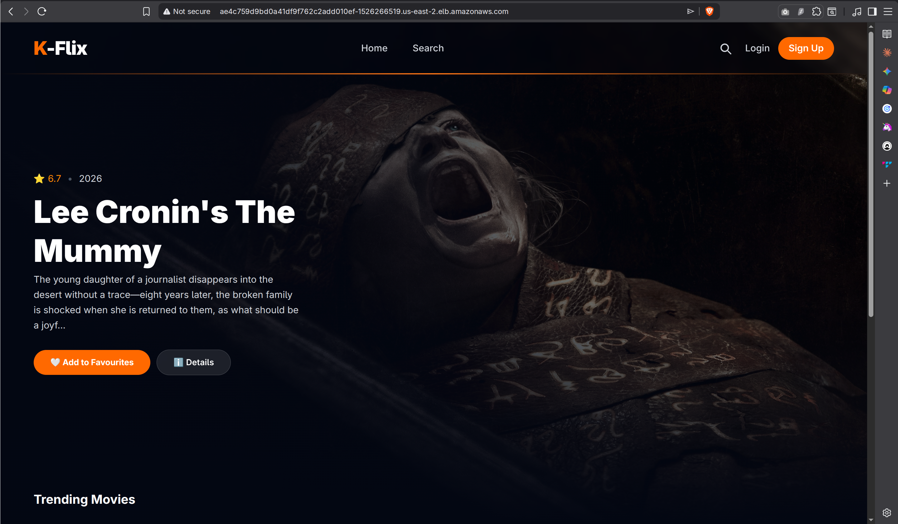

### App Working — Login & Watchlist
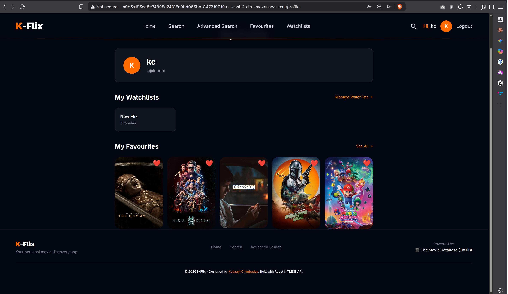

### Grafana — Kubernetes Metrics Dashboard
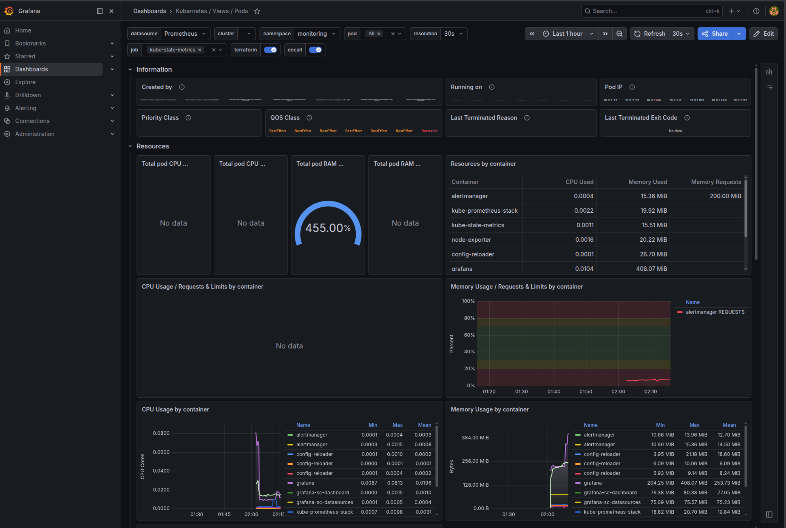

### Slack — Alerts Firing
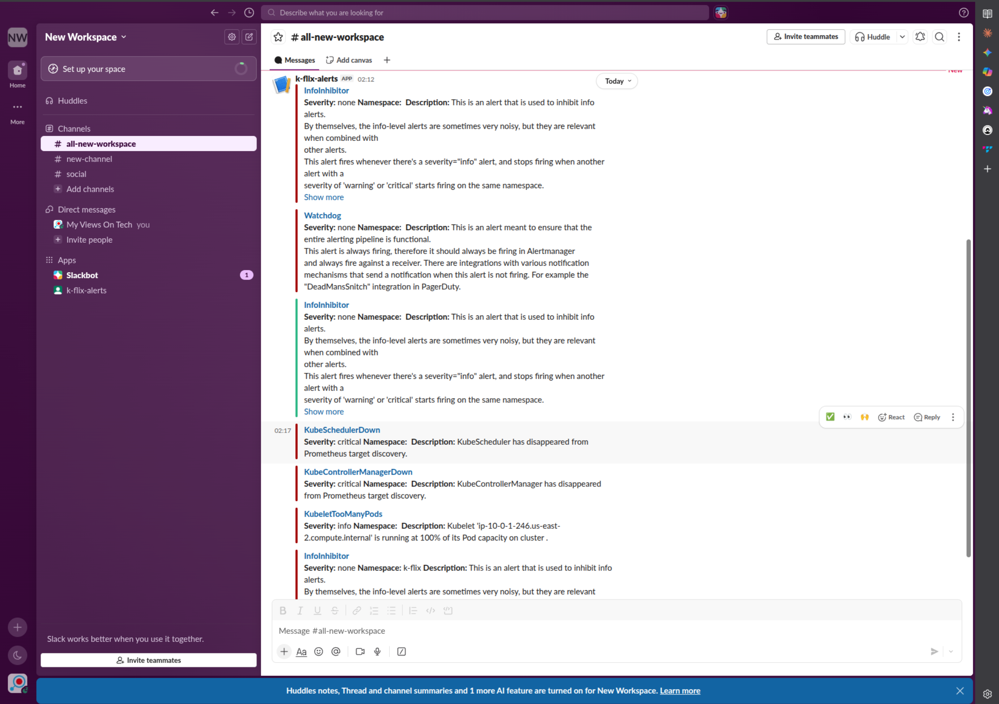

### Self-Healing — Pod Deleted and Rescheduled
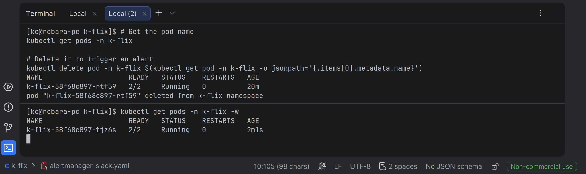

---

## Author

**Kudzayi Chimbodza**  
MSc Cyber-Physical Systems (IoT), Northeastern University Toronto  
[github.com/kchimbodza](https://github.com/kchimbodza) · [myviewsontech.com](https://myviewsontech.com)
